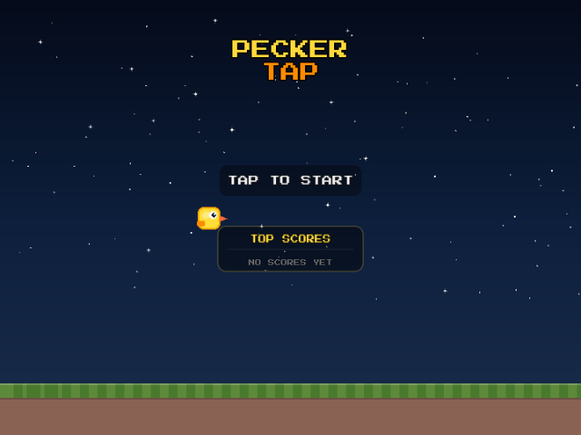

# Pecker Tap R36S

Dedicated, offline R36S edition of the existing Pecker Tap game. The original
project at `~/Desktop/peckertap` is not modified.

## What this builds

- Native 640×480 fullscreen game using the ARM64 LÖVE 11.5 runtime (SDL2/OpenGL ES).
- The browser game's procedural bird, pipes, clouds, audio, score persistence,
  and day → dusk → night → dawn sky cycle.
- The original “Skybound Peck” 8-bit soundtrack, synthesized locally at boot as
  three synchronized layers. Its arrangement builds with the score and softens
  naturally at night and during rain or storms.
- A relaxed procedural weather cycle spanning clear skies, breeze, rain, storms,
  and mist without affecting the original flight physics.
- Risk/reward golden feathers near pipe edges, with a persistent collection
  total and pickup effects. Bird colors permanently advance every ten saved
  feathers through yellow, pink, blue, green, purple, and finally black at 50.
  Three pixel hearts track the current life cycle. The unlocked color and feather
  count survive the first two deaths, then both reset after the third death.
- The flap, score, occasional real mallard double-quack, collectible sparkle,
  and original descending game-over jingle mixed over the soundtrack.
- Edge-to-edge 640×480 landscape playfield with the sky, clouds, stars, pipes,
  and ground extended across the entire LCD. There are no side instructions,
  branding, status panels, or decorative interface.
- A supervised `systemd` service that boots directly to the game and restarts
  after failures without an uncontrolled restart loop.
- A Pecker Tap boot splash and a recovery marker available on the FAT boot partition.
- A reusable PortMaster-style offline package and a dedicated ArkOS image overlay.

Normal boot is:

`POWER ON → ARKOS KERNEL/DRIVERS → PECKER TAP SPLASH → GAMEPLAY`

## Feature preview

| Storm collectible | Night sky |
|---|---|
|  |  |

There is no browser, Electron, X11 desktop, login prompt, or launcher in the
normal path.

On a freshly flashed card, ArkOS first expands/converts EASYROMS and performs
two automatic reboots. Pecker Tap deliberately waits until that process has
removed its first-boot script, then installs on the following boot. No input is
required. Subsequent boots follow the normal sequence above.

## Build and test

```sh
cd ~/Desktop/peckertap-r36s
bash scripts/fetch-dependencies.sh
bash scripts/verify.sh
bash scripts/build-port.sh
bash scripts/build-overlay.sh
```

Local visual test (uses the official LÖVE 11.5 macOS test runtime in `cache/`):

```sh
PECKERTAP_WINDOWED=1 cache/love-macos/love.app/Contents/MacOS/love game
```

## Build the customized image

1. Download and decompress the maintainer's R36S multipanel image into `cache/`.
2. Install `e2fsprogs` on the build Mac so `debugfs` can inject the first-boot payload.
3. Run:

```sh
bash scripts/customize-image.sh
```

This produces `dist/PeckerTap-R36S.img` and its SHA-256 checksum. Building the
image does not touch a physical SD card.

The image keeps the inserted R36S card's known-working `boot.ini` and active
DTBs, includes a copy under `BOOT/PeckerTap-Hardware-Backup`, and empties
EASYROMS only after ArkOS has mounted it successfully. The provisioning ROM
archive is then removed. EmulationStation is masked from the normal boot path.

## Flashing safety

Never guess a disk number. Run `diskutil list` immediately before flashing and
verify the exact device with `diskutil info`. The helper refuses internal and
non-removable devices and requires typing the exact disk identifier.

The current candidate observed on this Mac is `/dev/disk4`, a 128.0 GB card in
the built-in SDXC reader. That observation is not permanent authorization. The
disk must be re-identified and explicitly confirmed immediately before flashing.

## Controls

- Flap/start/restart: D-pad, analog stick up, A/B/X/Y, Start, or shoulder buttons.
- Safe shutdown: hold Select + Start for two seconds.
- macOS development: Space, Up, W, Return, Z, X, or mouse click.

## Recovery

See `docs/RECOVERY.txt`. The short version: insert the card into a computer,
create an empty `PECKERTAP_RECOVERY` file on the `BOOT` partition, and boot the
R36S. The game is skipped and the maintenance console/SSH service is enabled.
Remove the marker and reboot to return to the dedicated game.

## Updating the game

Rebuild `dist/peckertap-rootfs-overlay.tar.gz`, enter recovery mode, copy the
archive to the device, and extract it at `/` as root. Reboot after removing the
recovery marker. Saves live under `/var/lib/peckertap` and are not part of the
application bundle.

## Hardware status

The first dedicated image successfully booted and ran on the user's R36S. The
edge-to-edge landscape revision has passed local 640×480 day/night rendering and
static verification; it still needs to be reflashed and checked on the handheld.

See `docs/BUILD-MANIFEST.md` for artifact hashes and completed Mac-side checks.

## Repository artifacts

The repository includes the complete game source, audio/font licensing notices,
R36S system overlay, hardware-specific boot backup, build and flash tooling,
screenshots, PortMaster package, and root-filesystem update package. Downloaded
ArkOS/LÖVE caches, generated staging files, and the 7.4 GB raw SD-card image are
excluded from Git because they are reproducible and exceed GitHub's normal file
limits. Follow the build steps above to recreate the raw image locally.
